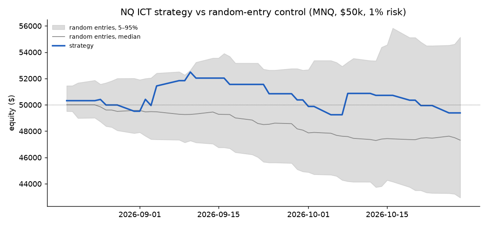

# ictbt — an event-driven backtester for a discretionary ICT futures playbook

This project turns a discretionary NQ day-trading playbook into exact rules and tests it honestly.
The playbook covers HTF FVG bias, OTE, liquidity sweeps, inversion FVGs, and NQ/ES SMT divergence.

* **RULES.md**: every discretionary step written as an exact rule.
* **REPORT.md**: results, a time split, ablations, cost sensitivity, and a random-entry control.

## Results so far

Demo run: 49 trading days of 5m NQ/ES bars (Aug–Oct 2026). Sized in MNQ on a $50K account at 1% risk, net of slippage and commissions.

| Trades | Win % | Expectancy | 95% CI | Sharpe | Max DD |
|---|---|---|---|---|---|
| 23 | 30% | −0.13R | [−0.64R, +0.48R] | −0.44 | −6.2% |

It beat 58% of 200 random-entry runs that use the same stops, targets and risk rules. That is indistinguishable from chance.
At 23 trades, the sample is too small to show an edge or rule one out. The next step is a multi-year 1m run
(`scripts/fetch_databento.py`).



## Run

```bash
uv venv --python 3.11 .venv && uv pip install --python .venv/bin/python pandas numpy matplotlib tabulate yfinance pytest
.venv/bin/python scripts/fetch_yf.py      # free demo data (~60 days of 5m)
.venv/bin/python -m pytest -q tests       # includes look-ahead tests
.venv/bin/python run.py                   # writes REPORT.md and equity.png
```

For real data, put `NQ_5m.csv`, `ES_5m.csv` and (optionally) `NQ_1h.csv` in a folder and pass `--data <dir>`.
Each file needs OHLCV columns plus a timestamp column. The timestamp may be tz-aware, or naive ET.

## How look-ahead is prevented

* The engine makes one pass over the bars. Decisions use information up to the close of bar t, and orders fill at the open of bar t+1.
* A swing pivot is used only after its k right-hand bars have closed.
* HTF bars carry an `end` time and are used only once that time has passed. Yahoo's 1h feed mixes :00 and :30 bars, so
  `end` waits for the last member bar to close.
* Session levels are added only after their window closes.
* **Tests:** the backtest is re-run on data truncated at four cut points, and again with every bar after a cut
  replaced by random noise. In both cases, every trade closed before the cut must be identical (`tests/test_backtest.py`).

## Layout

| file | purpose |
|---|---|
| `ictbt/config.py` | every rule parameter, in one frozen dataclass |
| `ictbt/features.py` | FVGs, swings, HTF resampling, HTF bias |
| `ictbt/engine.py` | bar loop: levels, confluence, triggers, risk state machine, fills and costs |
| `ictbt/metrics.py` | expectancy (R and $), bootstrap CI, Sharpe, max drawdown, profit factor |
| `run.py` | baseline, time split, ablations, cost sweep, random-entry control, report |
